# FootprintIQ

<p align="center">
  <strong>An Integrated OSINT Reconnaissance and Vulnerability Assessment Platform</strong>
</p>

<p align="center">
  
  
  
  
  
  
  
</p>

---

## Engineering Team

- **Asip Ali**
- **Mohan Prasad**

---

## Table of Contents

- [1. Project Overview](#1-project-overview)
  - [The Problem Space](#the-problem-space)
  - [Target Audience](#target-audience)
  - [Tri-Tier Reconnaissance Synergy](#tri-tier-reconnaissance-synergy)
  - [Investigations and Forensic Evidence Lifecycle](#investigations-and-forensic-evidence-lifecycle)
- [2. Key Features](#2-key-features)
  - [Investigation Management](#1-investigation-management)
  - [Passive Reconnaissance](#2-passive-reconnaissance)
  - [Active Reconnaissance](#3-active-reconnaissance)
  - [Vulnerability Assessment](#4-vulnerability-assessment)
  - [Findings and Risk Analysis](#5-findings-and-risk-analysis)
  - [Evidence Management](#6-evidence-management)
  - [Reporting and Analytics](#7-reporting-and-analytics)
  - [Authentication and Role-Based Access Control (RBAC)](#8-authentication-and-role-based-access-control-rbac)
  - [Scanner Orchestration & Privilege Authorization (PSA)](#9-scanner-orchestration-privilege-authorization-psa)
  - [Administrative Management](#10-administrative-management)
- [3. Technology Stack](#3-technology-stack)
- [4. System Architecture](#4-system-architecture)
- [5. Reconnaissance & Vulnerability Workflow](#5-reconnaissance-vulnerability-workflow)
- [6. Installation and Setup](#6-installation-and-setup)
  - [Prerequisites](#prerequisites)
  - [1. Repository Setup & Virtual Environment](#1-repository-setup-virtual-environment)
  - [2. Database Configuration (SQL Server 2022 Express)](#2-database-configuration-sql-server-2022-express)
  - [3. Database Migrations (Alembic)](#3-database-migrations-alembic)
  - [4. Distributed Object Storage (SeaweedFS)](#4-distributed-object-storage-seaweedfs)
  - [5. Scanner Verification](#5-scanner-verification)
  - [6. Running the Application](#6-running-the-application)
- [7. Configuration Reference](#7-configuration-reference)
- [8. Usage Guide](#8-usage-guide)
  - [Web Application Workflow](#web-application-workflow)
  - [Command-Line Interface (CLI) Execution](#command-line-interface-cli-execution)
- [9. Project Directory Structure](#9-project-directory-structure)
- [10. Database and Data Storage](#10-database-and-data-storage)
  - [SQL Server Architecture & Alembic Migrations](#sql-server-architecture-alembic-migrations)
  - [Resilient Repository Architecture](#resilient-repository-architecture)
  - [SeaweedFS Evidence Ledger & SHA-256 Integrity](#seaweedfs-evidence-ledger-sha-256-integrity)
- [11. Security Considerations](#11-security-considerations)
- [12. Testing and Troubleshooting](#12-testing-and-troubleshooting)
  - [Running the Automated Test Suite](#running-the-automated-test-suite)
  - [Common Troubleshooting Scenarios](#common-troubleshooting-scenarios)
- [13. Application Screenshots](#13-application-screenshots)
  - [A. Application Dashboard](#a-application-dashboard)
  - [B. Reconnaissance Campaign Management](#b-reconnaissance-campaign-management)
  - [C. Create New Investigation](#c-create-new-investigation)
  - [D. Reconnaissance Workspace](#d-reconnaissance-workspace)
  - [E. Vulnerability Findings & Correlation](#e-vulnerability-findings--correlation)
  - [F. Integrated Security Assessment Report](#f-integrated-security-assessment-report)
  - [G. Administrator & Governance](#g-administrator--governance)
- [14. Roadmap](#14-roadmap)
- [15. Responsible Use](#15-responsible-use)
- [16. License and Contribution](#16-license-and-contribution)

---

## 1. Project Overview

**FootprintIQ** is an enterprise-grade digital footprint investigation, OSINT reconnaissance, active network discovery, multi-scanner vulnerability assessment, and forensic evidence correlation platform.

### The Problem Space

Modern offensive and defensive security operations require investigators to correlate data across multiple isolated domains:
1. **Passive OSINT** (WHOIS, DNS records, public email discovery, domain infrastructure).
2. **Active Network Discovery** (TCP/UDP port scanning, service enumeration, OS fingerprinting).
3. **Vulnerability Scanners** (CVE identification, web misconfigurations, SSL/TLS flaws).
4. **Forensic Evidence & Audit Chains** (immutable storage, raw scanner outputs, cryptographic verification).

Traditionally, security teams run disjointed CLI tools, manually parse inconsistent XML/JSON files, copy evidence into spreadsheets, and struggle to establish provenance or track remediation over time. 

FootprintIQ solves this fragmentation by unifying passive intelligence collection, controlled active scanning, template-driven vulnerability assessments, cryptographic evidence preservation, differential report analysis, and entity graph correlation into a cohesive web platform and REST API.

### Target Audience

- **Cybersecurity Investigators & OSINT Practitioners:** Track digital footprints, correlate registrant entities, and identify external exposures.
- **Penetration Testers & Red Teams:** Conduct authorized pre-engagement reconnaissance, service mapping, and vulnerability discovery under strict scoping constraints.
- **Vulnerability Management & SOC Analysts:** Track findings across repeated scans, evaluate exposure trends, monitor remediation velocity, and maintain evidentiary audit trails.
- **Enterprise Security Auditors:** Validate multi-scanner corroboration, generate executive/technical PDF reports, and inspect tamper-proof SHA-256 evidence logs.

### Tri-Tier Reconnaissance Synergy

FootprintIQ organizes security assessments into three synergistic phases:

```
[ Phase 1: Passive Recon ]  -->  [ Phase 2: Active Recon ]  -->  [ Phase 3: Vulnerability Assessment ]
  • WHOIS / RDAP                   • Host Discovery                • ProjectDiscovery Nuclei
  • DNS Enumeration                • TCP / UDP Port Scanning       • Policy-Enforced Nmap NSE
  • theHarvester Intelligence      • Service & OS Detection        • Tenable Nessus Adapter
  (Zero Target Interaction)        (Controlled Probing)            (Deep Defect Verification)
                                            │
                                            ▼
                             [ Normalization & Correlation ]
                               • Unified Finding Model
                               • Asymptotic Risk Scoring (0-100)
                               • Entity Graph (Maltego/GraphML)
                               • SeaweedFS Evidence Ledger
```

1. **Passive OSINT** identifies public domain infrastructure, IP blocks, nameservers, and registrant data without touching the target's network.
2. **Active Network Reconnaissance** probes authorized endpoints discovered during passive intel, establishing open ports, running daemons, and operating system fingerprints.
3. **Vulnerability Assessment** selectively launches targeted vulnerability checks against active listening services, avoiding blind, noisy scans and focusing validation where services are confirmed online.

### Investigations and Forensic Evidence Lifecycle

In FootprintIQ, all security actions are scoped within **Investigations** (Recon Campaigns):
- **Fail-Closed Target Authorization:** Only targets registered in `config/target_authorization.json` or explicitly authorized by an administrator can be scanned.
- **Immutable Run Ledger:** Every scan execution is versioned (`Run 001`, `Run 002`, etc.) with start/end timestamps, duration, scan type, profile parameters, and exit codes.
- **Cryptographic Evidence Tracking:** Raw scanner outputs (`.xml`, `.jsonl`, `.nessus`, `.txt`) are uploaded to SeaweedFS distributed object storage, indexed with SHA-256 digests, and linked directly to normalized findings.
- **Remediation Lifecycle:** Findings can be transitioned through structured states (`open`, `in_progress`, `resolved`, `accepted_risk`, `false_positive`) with mandatory investigator notes and audit records.

---

## 2. Key Features

### 1. Investigation Management
- **Streamlined Recon Creation:** Simple creation workflow requiring only Recon Name, Target (domain, IPv4, range), and Purpose, without overwhelming initial scanner configuration.
- **Multi-Run History:** Track successive scans against the same target over time, preserving historical execution records, scanner parameters, and finding deltas.
- **Target Scoping & Validation:** Strict verification of input syntax (CIDR, IP, domain) with automatic fail-closed boundary enforcement.
- **Investigation Collaboration:** Fine-grained sharing of investigations between investigators with read/write permission levels.

### 2. Passive Reconnaissance
- **WHOIS & RDAP Lookup:** Detailed registrar details, administrative/technical contacts, creation/expiration dates, and ASN assignments.
- **DNS Intelligence:** Resolves A, AAAA, MX, NS, TXT, CNAME, SOA, and PTR records; performs automated reverse DNS enumeration.
- **theHarvester Integration:** Automates search-engine OSINT to discover employee names, public email addresses, hosts, and subdomains.
- **External Threat Intel (Optional):** Modular collectors for Shodan and VirusTotal IP/domain reputation when API keys are supplied.

### 3. Active Reconnaissance
- **Nmap Network Discovery:** ICMP echo, TCP SYN discovery (`-PS`), and standard TCP ping probes.
- **Comprehensive Port Scanning:** Fast Top 100, standard Top 1000, or full `1-65535` port ranges across TCP and UDP protocols.
- **Service & Version Detection:** Deep version fingerprinting (`-sV`) with banner grab analysis and cpe parsing.
- **Operating System Fingerprinting:** TCP/IP stack OS detection (`-O`) with confidence ratings.
- **Timing & Performance Profiles:** Tuned timing templates (`-T3` default, `-T4` aggressive) with configurable probe parallelism.

### 4. Vulnerability Assessment
- **ProjectDiscovery Nuclei:** Policy-governed execution of 9,000+ official community YAML templates targeting CVEs, misconfigurations, exposed admin interfaces, default credentials, and SSL/TLS vulnerabilities.
- **Policy-Controlled Nmap NSE:** Allowlisted Nmap Scripting Engine execution spanning HTTP, SSL/TLS, SMB, SSH, FTP, and DNS security checks. Dangerous or intrusive scripts are strictly blocked by `NSEPolicyService`.
- **Tenable Nessus REST API Integration:** Enterprise adapter supporting API key authentication, dynamic scan template discovery, live scan launch/monitoring, report export (`.nessus`, `.csv`), and finding import.
- **Historical Report Ingestion:** Built-in XML parser for legacy Greenbone/OpenVAS vulnerability reports to preserve historical audit data without requiring an active daemon.

### 5. Findings and Risk Analysis
- **Unified Finding Normalization:** All scanner outputs are translated into a standardized `VulnerabilityFinding` model with CVSS v3.1 base score, severity tier (Critical, High, Medium, Low, Info), CVE identifiers, affected ports, and plain-English remediation advice.
- **Asymptotic Exposure Scoring (0 - 100):** Mathematical exposure engine that computes risk based on finding severities, open port attack surfaces, asset criticality, and multi-scanner corroboration bonuses.
- **Corroboration Engine:** Cross-validates findings reported by multiple scanners (e.g., Nmap service discovery corroborated by Nuclei HTTP banner match) to elevate confidence scores.
- **Remediation Tracking:** Full lifecycle state management with audit logs capturing which investigator modified a finding's status and why.

### 6. Evidence Management
- **Distributed SeaweedFS Object Storage:** Stores original raw artifacts across master and volume servers (`weed v3.64`).
- **Resilient Local Cache Fallback:** Automatically caches evidence locally (`data/evidence_cache/`) when SeaweedFS is offline.
- **SHA-256 Cryptographic Verification:** Calculates and records file size and SHA-256 digest on upload; re-verifies integrity on retrieval to prevent tampering.
- **Evidence Ledger UI:** Dedicated investigator interface to search, preview, inspect, and download raw evidence files.

### 7. Reporting and Analytics
- **Professional PDF Generation (ReportLab):** Generates Executive, Technical Assessment, and Combined Multi-Scanner Audit PDF reports with cover pages, risk matrices, and evidence appendices.
- **Integrated Report Analysis:** In-depth web interface featuring run-over-run differential comparison, attack surface changes (new/closed ports, resolved CVEs), and remediation velocity charts.
- **Entity & Relationship Graph (Maltego Compatible):** Visualizes the correlation graph connecting targets, domains, IP addresses, open ports, software services, and detected vulnerabilities. Exports directly to GraphML and CSV for import into Maltego Desktop.

### 8. Authentication and Role-Based Access Control (RBAC)
- **Centralized Default-Deny Authorization:** Every API endpoint and template route independently validates permissions through `rbac_service.py`.
- **Two Primary Roles:**
  - `admin`: User administration, scanner readiness testing, system diagnostics, and audit log inspection (read-only over investigations; cannot execute scans).
  - `investigator`: Full ownership and execution capabilities over assigned investigations, scan configuration, and report generation (restricted from administrative panels).
- **Dual Authentication Modes:** Supports both HTTP Bearer JWT tokens (for REST API / CLI automation) and HTTP-only session cookies with CSRF tokens (for web dashboard security).
- **Password Security:** Salted bcrypt password hashing with strict password complexity requirements and account activity auditing.

### 9. Scanner Orchestration & Privilege Authorization (PSA)
- **Durable Background Execution:** Non-blocking scan jobs running in asynchronous background worker threads with real-time SSE telemetry broadcasting.
- **Privilege Consent & Authorization (PSA):**
  - Explicit consent checkbox required for Active Recon and Vulnerability Assessment scans that require raw-packet privileges.
  - Server-side `PrivilegeDetector` analyzes Nmap and NSE flags to identify raw socket operations (`-sS`, `-sU`, `-O`, ARP discovery, raw NSE scripts).
  - Prompts for investigator FootprintIQ account password re-verification (never prompts for or accepts Kali root passwords).
  - Issues an ephemeral, single-use cryptographic authorization ticket with a 300-second (5-minute) TTL bound to `(user_id, recon_id, target, approved_operations)`.
  - **Scenario A (No Consent):** Automatically downgrades to safe unprivileged alternatives (`-sT` instead of `-sS`, skips OS detection and UDP) with honest telemetry logging.
  - **Scenario B (Consent + Identity Verified):** Executes authorized elevated scans via restricted `PrivilegedExecutor`.
  - **Scenario C (Verification Failed):** Rejects elevation with 401 Unauthorized and logs a security audit event.
  - **Scenario D (Ticket Replay / Mismatch):** Single-use consumption prevents replay attacks; mismatches return 403 Forbidden.
  - **Scenario E (Execution Failure):** Captures non-zero return codes and stderr honestly without inventing scan success.
- **Restricted Execution Wrapper:** `PrivilegedExecutor` runs `/usr/bin/nmap` with `shell=False` and strict regex allowlists that reject shell metacharacters (`;`, `&`, `|`, `$`, `` ` ``).

### 10. Administrative Management
- **User Management Portal:** Provision, activate, deactivate, and assign roles to platform accounts.
- **Scanner Operational Health:** Real-time dashboard testing connectivity, binary versions, and template counts for Nmap, Nuclei, and Tenable Nessus.
- **Immutable Security Audit Trail:** Persistent log tracking every login, password change, investigation creation, target authorization, scan execution, and PSA verification event with sensitive parameter redaction.

---

## 3. Technology Stack

| Layer | Technology | Version | Purpose in FootprintIQ |
|---|---|---|---|
| **Backend Framework** | FastAPI | 0.162.3 | High-performance asynchronous REST API & Jinja2 routing |
| **ASGI Web Server** | Uvicorn | 0.54.0 | Asynchronous HTTP/1.1 and WebSocket server |
| **Data Validation** | Pydantic | 2.14.3 | Strict request/response schema modeling and validation |
| **Programming Language** | Python | 3.13.9 | Core application runtime |
| **Database Engine** | Microsoft SQL Server Express | 2022 | Enterprise relational database storage with ACID guarantees |
| **Database Driver** | pymssql / SQLAlchemy | 2.4.6 / 2.1.8 | Pure T-SQL database connectivity and ORM mapping |
| **Schema Migrations** | Alembic | 1.20.1 | Version-controlled, reversible T-SQL database migrations (001–006) |
| **Evidence Storage** | SeaweedFS | 3.64 (weed) | High-throughput distributed object storage with volume replication |
| **Network Discovery** | Nmap | 7.991 | Host discovery, port enumeration, service/OS detection |
| **Vulnerability Scanner** | ProjectDiscovery Nuclei | 3.11.1 | Template-based vulnerability, CVE, and misconfiguration scanning |
| **Enterprise Scanner** | Tenable Nessus REST API | v10.x API | Authenticated scan creation, monitoring, and report extraction |
| **Passive OSINT** | theHarvester / whois / dnspython | Latest | Public email, subdomain, WHOIS, RDAP, and DNS enumeration |
| **PDF Reporting** | ReportLab | 5.1.0 | Programmatic Executive and Technical PDF report generation |
| **Security & Auth** | PyJWT / bcrypt / cryptography | Latest | JWT tokens, salted password hashing, and CSRF protection |
| **Frontend UI** | Jinja2 / Vanilla ES6+ / CSS3 | 3.1.6 | Responsive light-theme dashboard, live telemetry, and results UI |

---

## 4. System Architecture

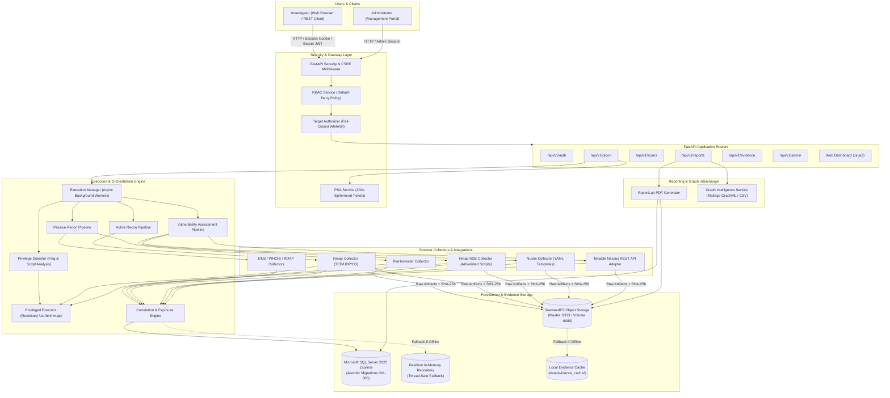

---

## 5. Reconnaissance & Vulnerability Workflow

```
[Target: Domain / IPv4]
          │
          ├──────────────────────────────────────────────────────┐
          ▼                                                      ▼
[ Phase 1: Passive OSINT ]                             [ Target Scope Check ]
  • theHarvester (Emails, Subdomains)                    • Fail-closed validation
  • WHOIS / RDAP (Registrar, ASN)                        • target_authorization.json
  • DNS Enumeration (A, MX, NS, TXT)                             │
          │                                                      ▼
          └────────────────────────────────────────────► [ Authorized Target ]
                                                                 │
          ┌──────────────────────────────────────────────────────┘
          ▼
[ Phase 2: Controlled Active Recon ]
  • Host Discovery (ICMP / TCP Ping)
  • Port Scanning (Top 100, Top 1000, 1-65535)
  • Service & Version Detection (-sV)
  • OS Fingerprinting (-O)
  • PSA Enforcement:
    ├─ Consent Given + Verified: Elevated SYN/UDP/OS
    └─ No Consent: Unprivileged Fallback (-sT)
          │
          ▼
[ Discovered Services & Open Ports ]
          │
          ▼
[ Phase 3: Vulnerability Assessment ]
  • Nuclei Safe Template Scanning (CVEs, Exposures)
  • Policy-Enforced Nmap NSE (Allowlisted checks)
  • Tenable Nessus API (Authenticated live scans)
          │
          ▼
[ Normalization & Translation ]
  • Convert diverse outputs to VulnerabilityFinding schema
  • Map CVSS v3.1 base scores & severities
  • Associate raw artifacts with SHA-256 hashes
          │
          ▼
[ Exposure Scoring & Correlation ]
  • Compute Asymptotic Risk Score (0 - 100)
  • Corroborate cross-scanner findings
  • Generate Entity & Relationship Graph
          │
          ▼
[ Forensic Reports & Remediation ]
  • Executive & Technical PDF Reports
  • Evidence Ledger in SeaweedFS
  • Differential Report Analysis
```

---

## 6. Installation and Setup

### Prerequisites

- **Operating System:** Linux (Kali Linux 2025.x or Ubuntu 22.04+ recommended)
- **Python:** Python 3.13+
- **System Tools:**
  - `nmap` (v7.90+)
  - `git`
  - `curl`
  - `libmagic` / development headers
- **External Services (Optional for Production):**
  - Microsoft SQL Server 2022 Express / Developer Edition
  - SeaweedFS binary (`weed`)
  - ProjectDiscovery Nuclei (`nuclei`)
  - Tenable Nessus (optional enterprise scanner)

### 1. Repository Setup & Virtual Environment

Clone the repository and create an isolated Python 3.13 virtual environment:

```bash
# Clone the repository
git clone https://github.com/asip-ali/FootprintIQ.git
cd FootprintIQ

# Create Python 3.13 virtual environment
python3 -m venv .venv

# Activate the virtual environment
source .venv/bin/activate

# Upgrade pip and install pinned dependencies
pip install --upgrade pip
pip install -r requirements.txt
```

### 2. Database Configuration (SQL Server 2022 Express)

FootprintIQ uses Microsoft SQL Server as its primary persistence engine.

1. Ensure SQL Server 2022 is running and listening on port `1433`:
   ```bash
   sudo systemctl status mssql-server
   ```
2. Create the application database:
   ```bash
   sqlcmd -S 127.0.0.1 -U sa -P 'YourStrongPassword!' -Q "CREATE DATABASE FootprintIQ;"
   ```
3. Copy `.env.example` to `.env` and set your connection details:
   ```bash
   cp .env.example .env
   ```
   Configure the database parameters in `.env`:
   ```env
   SQL_SERVER_HOST=127.0.0.1
   SQL_SERVER_PORT=1433
   SQL_SERVER_USER=sa
   SQL_SERVER_PASSWORD=YourStrongPassword!
   SQL_SERVER_DATABASE=FootprintIQ
   SQL_SERVER_DRIVER=pymssql
   ```

> [!NOTE]
> **Resilient Fallback Mode:** If SQL Server is unavailable (e.g., in a standalone testing container or during local development without SQL Server installed), FootprintIQ automatically activates its thread-safe in-memory repository fallback. All features, scans, and reports will function normally in memory.

### 3. Database Migrations (Alembic)

FootprintIQ uses Alembic to manage reversible T-SQL database migrations:

```bash
# Preview generated T-SQL without applying:
alembic upgrade head --sql

# Apply migrations to the live database:
alembic upgrade head
```

The migration tree contains 6 progressive schema revisions:
- `001_initial_sql_server_schema.py`: Core tables (investigations, targets, scans, findings, evidence, audit logs).
- `002_recon_campaigns_and_events.py`: Recon campaigns, scan execution events, and saved profiles.
- `003_acid_constraints_and_indexes.py`: Foreign key cascades, check constraints, and performance indexes.
- `004_rbac_audit_and_reports.py`: Users, roles, RBAC audit logs, and report records.
- `005_upgrade_runs_reports.py`: Multi-run scan executions, remediation tracking, and report analysis.
- `006_privilege_consent_authorization.py`: PSA tracking columns on `ScanExecution`.

### 4. Distributed Object Storage (SeaweedFS)

FootprintIQ preserves original scanner outputs and generated PDF reports in SeaweedFS.

1. Download and install the SeaweedFS binary:
   ```bash
   # Download SeaweedFS v3.64 for Linux AMD64
   wget https://github.com/seaweedfs/seaweedfs/releases/download/3.64/linux_amd64.tar.gz
   tar -xzf linux_amd64.tar.gz
   mv weed ~/.local/bin/
   ```
2. Launch the SeaweedFS master and volume server:
   ```bash
   weed server -dir=./data/seaweedfs -ip=127.0.0.1 -master.port=9333 -volume.port=8080 -filer=false -s3=false -webdav=false &
   ```
3. Verify SeaweedFS is operational:
   ```bash
   curl -s http://127.0.0.1:9333/dir/assign
   ```

> [!NOTE]
> If SeaweedFS is offline, FootprintIQ transparently preserves evidence artifacts in the local directory `data/evidence_cache/` with complete SHA-256 hashing.

### 5. Scanner Verification

Verify that Nmap and Nuclei are properly installed and accessible:

```bash
# Check Nmap
nmap --version

# Check Nuclei
nuclei -version

# Run FootprintIQ subsystem readiness diagnostics
python main.py --check-readiness
```

### 6. Running the Application

Launch the FootprintIQ FastAPI application and web dashboard:

```bash
# Start server using main.py CLI entry point
python main.py --server --host 0.0.0.0 --port 8000

# Or start directly using Uvicorn
uvicorn src.api.app:app --host 0.0.0.0 --port 8000
```

- **Web Dashboard:** `http://localhost:8000/`
- **Login Portal:** `http://localhost:8000/login`
- **System Health Diagnostics:** `http://localhost:8000/api/v1/health`
- **Interactive API Documentation (Swagger UI):** `http://localhost:8000/docs` (accessible when logged in, or when `ENABLE_PUBLIC_API_DOCS=true`)

---

## 7. Configuration Reference

All application settings are managed via environment variables or the `.env` file:

| Environment Variable | Description | Default Value | Required |
|---|---|---|:---:|
| `DATABASE_URL` | Full SQLAlchemy connection string (overrides individual SQL Server keys) | `None` | No |
| `SQL_SERVER_HOST` | Host IP or hostname of Microsoft SQL Server | `127.0.0.1` | Yes (for SQL Server) |
| `SQL_SERVER_PORT` | Port number of Microsoft SQL Server | `1433` | Yes (for SQL Server) |
| `SQL_SERVER_USER` | SQL Server authentication username | `sa` | Yes (for SQL Server) |
| `SQL_SERVER_PASSWORD` | SQL Server authentication password | `FootprintIQ2026!` | Yes (for SQL Server) |
| `SQL_SERVER_DATABASE` | Target database catalog name | `FootprintIQ` | Yes (for SQL Server) |
| `SQL_SERVER_DRIVER` | Database connection driver (`pymssql` or `pyodbc`) | `pymssql` | No |
| `ODBC_DRIVER` | ODBC driver name when using `pyodbc` | `ODBC Driver 18 for SQL Server` | No |
| `JWT_SECRET_KEY` | Secret key used to sign and verify JWT authentication tokens | `FootprintIQ-SuperSecretKey-2026-ProductionSafe` | Yes (Production) |
| `NMAP_PATH` | Explicit filesystem path to `/usr/bin/nmap` executable | Auto-detected | No |
| `NUCLEI_BINARY` | Explicit filesystem path to `nuclei` executable | Auto-detected | No |
| `NUCLEI_TEMPLATES_DIR`| Path to ProjectDiscovery YAML templates directory | `~/.local/nuclei-templates` | No |
| `NESSUS_URL` | Base URL of Tenable Nessus REST API | `https://127.0.0.1:8834` | No |
| `NESSUS_ACCESS_KEY` | API Access Key for Tenable Nessus authentication | `None` | No |
| `NESSUS_SECRET_KEY` | API Secret Key for Tenable Nessus authentication | `None` | No |
| `NESSUS_VERIFY_SSL` | Enable TLS certificate verification for Nessus API | `false` | No |
| `NESSUS_DEFAULT_TEMPLATE_UUID` | Preferred default Nessus scan template UUID | Auto-discovered | No |
| `SEAWEEDFS_MASTER_URL` | HTTP endpoint of SeaweedFS master server | `http://127.0.0.1:9333` | No |
| `EVIDENCE_CACHE_DIR` | Filesystem path for local evidence caching | `data/evidence_cache` | No |
| `ENABLE_PUBLIC_API_DOCS` | Allow unauthenticated access to `/docs` and `/redoc` | `false` | No |
| `SHODAN_API_KEY` | Optional API key for Shodan OSINT data enrichment | `None` | No |
| `VIRUSTOTAL_API_KEY` | Optional API key for VirusTotal domain/IP reputation | `None` | No |

---

## 8. Usage Guide

### Web Application Workflow

#### 1. Authentication & Role Selection
Navigate to `http://localhost:8000/login`. FootprintIQ provides built-in demo accounts for role evaluation:
- **Investigator:** Username `investigator1`, Password `Investigator1Pass2026!`
- **Administrator:** Username `admin`, Password `AdminPass2026!`

#### 2. Create an Investigation (Recon Campaign)
1. In the sidebar navigation, select **New Recon** (`/recon/create`).
2. Supply the three essential parameters:
   - **Recon Name:** e.g., `Lab Security Assessment`
   - **Target:** e.g., `192.168.56.111` or `scanme.nmap.org`
   - **Purpose:** e.g., `Vulnerability verification and compliance check`
3. Click **Create Recon**. The system creates the campaign, validates scope against `target_authorization.json`, and redirects to the **Recon Workspace**.

#### 3. Configure Scans in the Workspace
The Recon Workspace separates scanner selection into dedicated tabs:
- **Passive Reconnaissance:** Enable WHOIS/RDAP, DNS enumeration, and theHarvester.
- **Active Reconnaissance:** Select Port Mode (Top 100, Top 1000, Custom Range `1-65535`), TCP Scan Mode (SYN Stealth or Connect), OS Detection, and Timing Profile.
- **Vulnerability Assessment:** Toggle ProjectDiscovery Nuclei templates (HTTP security, misconfigurations, CVEs, SSL/TLS) or select allowlisted Nmap NSE script categories.

#### 4. Privileged Scan Authorization (PSA)
If you configure operations requiring elevated raw-packet privileges (such as TCP SYN scans `-sS` or OS fingerprinting `-O`):
1. The **Privilege Consent Checkbox** displays: *"I authorize FootprintIQ to request elevated privileges for scan operations that require them."*
2. Check the box and click **Start Scan**.
3. A security modal appears prompting you to confirm your **FootprintIQ account password**.
4. Upon successful verification, an ephemeral single-use ticket (300s TTL) is generated, and the scan launches with elevated privileges.
5. If consent is omitted, the scan automatically downgrades to safe unprivileged alternatives (`-sT`, omitting OS/UDP) without failing.

#### 5. Monitor Live Execution Telemetry
Clicking start redirects to the **Live Telemetry** dashboard (`/recon/{id}/live`):
- Watch real-time Server-Sent Events (SSE) streaming scanner logs.
- Monitor active stage indicators (Discovery → Port Scanning → Service Fingerprinting → Vulnerability Checks).
- Review execution state badges (`Running`, `Completed`, `Elevated Privileges`, `Unprivileged Fallback`).

#### 6. Inspect Findings & Correlation Graph
Upon scan completion, navigate to **Results** (`/recon/{id}/results`):
- Review the asymptotic **Risk Score** (0 - 100) and severity breakdown.
- Inspect the **Discovered Ports & Services** table.
- Filter the **Vulnerability Findings** table by severity, scanner source, and CVE.
- View the interactive **Entity & Relationship Graph** correlating targets, ports, software versions, and detected defects.

#### 7. Evidence Ledger & Integrity Verification
Navigate to **Evidence** (`/evidence`):
- View raw scanner artifacts (`.xml`, `.jsonl`, `.txt`) indexed by investigation and scan run.
- Inspect the file size and cryptographic SHA-256 checksum.
- Download artifacts directly from SeaweedFS or preview them in the browser.

#### 8. Generate & Analyze Reports
Navigate to **Reports** (`/reports`):
- Click **Generate Report** and select report type:
  - **Executive Report:** High-level summary, risk score, compliance posture, and critical defect breakdown.
  - **Technical Report:** Deep vulnerability tables, CVSS scores, remediation advice, and evidence appendices.
  - **Combined Multi-Scanner Report:** Unified audit document synthesizing passive, active, and vulnerability intelligence.
- Open **Report Analysis** to perform run-over-run differential comparisons and monitor remediation velocity over time.

---

### Command-Line Interface (CLI) Execution

In addition to the web dashboard, FootprintIQ provides a comprehensive CLI for automated scanning and pipelines:

```bash
# 1. Run Comprehensive Platform Diagnostics:
python main.py --health

# 2. Check Scanner Availability & Template Counts:
python main.py --check-readiness

# 3. Passive OSINT Reconnaissance:
python main.py example.com --timeout 30

# 4. Controlled Active Network Scan against Lab VM:
python main.py --active --target 192.168.56.111 --profile lab-basic

# 5. ProjectDiscovery Nuclei Safe Template Scan:
python main.py --unified-scan nuclei --target 192.168.56.111

# 6. Policy-Controlled Nmap NSE Vulnerability Assessment:
python main.py --unified-scan nmap_nse --target 192.168.56.111

# 7. Combined Multi-Scanner Assessment (Nmap + NSE + Nuclei):
python main.py --unified-scan combined --target 192.168.56.111

# 8. Multi-Source Intelligence Correlation (W4 Engine):
python main.py --correlate \
  --passive-input data/processed/SCAN-PASSIVE_report.json \
  --active-input data/processed/SCAN-ACTIVE_report.json

# 9. Output Clean Raw JSON to stdout:
python main.py --unified-scan combined --target 192.168.56.111 --json-only
```

---

## 9. Project Directory Structure

```text
FootprintIQ/
├── alembic/                         # Alembic database migration environment
│   ├── env.py                       # Migration runner configured for MSSQL
│   └── versions/                    # Reversible T-SQL migration scripts
│       ├── 001_initial_sql_server_schema.py
│       ├── 002_recon_campaigns_and_events.py
│       ├── 003_acid_constraints_and_indexes.py
│       ├── 004_rbac_audit_and_reports.py
│       ├── 005_upgrade_runs_reports.py
│       └── 006_privilege_consent_authorization.py
├── config/                          # Configuration registries & schemas
│   ├── target_authorization.json    # Fail-closed authorized target whitelist
│   ├── correlation_config.json      # Correlation rules and scoring weights
│   └── recon_schema.json            # JSON schema validation definitions
├── data/                            # Persistent evidence and scan artifacts
│   ├── evidence_cache/              # SeaweedFS local cache and offline evidence
│   ├── processed/                   # Normalized scan result JSON bundles
│   ├── raw/nse/                     # Raw Nmap NSE XML output files
│   └── seaweedfs/                   # SeaweedFS volume data directory
├── reports/                         # Generated Executive and Technical PDF reports
├── src/                             # Core application source code
│   ├── api/                         # FastAPI application and routing layer
│   │   ├── app.py                   # Application initialization, middleware, lifecycle
│   │   ├── dependencies.py          # Security, RBAC, and repository injection
│   │   └── routers/                 # Modular API & Web view endpoints
│   │       ├── admin.py             # User provisioning and system telemetry
│   │       ├── auth.py              # Login, token issuance, logout, user profile
│   │       ├── evidence.py          # Evidence ledger and artifact download
│   │       ├── findings.py          # Normalized vulnerability finding queries
│   │       ├── graph.py             # Entity relationship graph endpoints
│   │       ├── health.py            # Comprehensive subsystem health diagnostics
│   │       ├── investigations.py    # Investigation campaign management
│   │       ├── nessus.py            # Nessus connection test and scan endpoints
│   │       ├── nuclei.py            # Nuclei readiness and template catalog
│   │       ├── recon.py             # Recon creation, workspace, PSA, and scan launch
│   │       ├── reports.py           # Report generation, analysis, and PDF downloads
│   │       ├── scans.py             # Historical scan queries and status
│   │       ├── targets.py           # Target scope management
│   │       └── ui.py                # Jinja2 dashboard and workspace rendering
│   ├── authorization/               # Fail-closed target authorizer
│   │   └── target_authorizer.py     # Network scope and target whitelist validator
│   ├── collectors/                  # Multi-scanner integration adapters
│   │   ├── dns_collector.py         # DNS record resolver and reverse DNS
│   │   ├── nessus_collector.py      # Tenable Nessus REST API adapter
│   │   ├── nmap_collector.py        # Nmap network scanner and port discovery
│   │   ├── nse_collector.py         # Policy-enforced Nmap NSE script runner
│   │   ├── nuclei_collector.py      # ProjectDiscovery Nuclei YAML runner
│   │   ├── passive_intel_collector.py # Comprehensive passive OSINT engine
│   │   ├── rdap_collector.py        # ICANN RDAP registration lookup
│   │   ├── theharvester_collector.py# theHarvester public OSINT collector
│   │   └── whois_collector.py       # Domain and IP WHOIS parser
│   ├── correlation/                 # Multi-source intelligence synthesis
│   │   ├── asset_profile_builder.py # Aggregates host intelligence
│   │   ├── asset_resolver.py        # Canonical asset identifier resolver
│   │   ├── confidence_engine.py     # Cross-tool corroboration confidence
│   │   ├── correlation_engine.py    # Main correlation pipeline orchestrator
│   │   ├── evidence_linker.py       # Links evidence files to findings
│   │   ├── intelligence_graph.py    # In-memory entity graph model
│   │   └── relationship_builder.py  # Builds graph edges and associations
│   ├── db/                          # Database persistence layer
│   │   ├── models.py                # SQLAlchemy ORM models (SQL Server dialect)
│   │   ├── repository.py            # Data repository with in-memory fallback
│   │   └── session.py               # Engine connection pooling and session maker
│   ├── orchestration/               # Asynchronous scan execution pipelines
│   │   ├── active_pipeline.py       # Controlled Nmap active reconnaissance
│   │   ├── execution_manager.py     # Background worker and SSE telemetry broadcaster
│   │   ├── passive_pipeline.py      # Multi-collector passive OSINT pipeline
│   │   ├── unified_orchestrator.py  # Multi-scanner unified assessment orchestrator
│   │   └── vulnerability_pipeline.py# Nuclei and NSE vulnerability pipeline
│   ├── processors/                  # Finding normalization & deduplication
│   │   ├── finding_translator.py    # Translates scanner outputs to unified schema
│   │   └── vulnerability_normalizer.py # CVSS scoring and severity normalization
│   ├── reporting/                   # Automated PDF report generation
│   │   ├── correlation_report.py    # Correlation summary PDF builder
│   │   ├── pdf_generator.py         # Core ReportLab styling and layout engine
│   │   ├── unified_report.py        # Executive and Technical assessment builder
│   │   └── vulnerability_report.py  # Standalone vulnerability audit builder
│   ├── security/                    # Privileged execution & authentication security
│   │   ├── privilege_detector.py    # Raw-packet flag analysis and unprivileged fallback
│   │   ├── privileged_executor.py   # Restricted /usr/bin/nmap execution wrapper
│   │   └── psa_service.py           # Ephemeral single-use authorization ticket registry
│   ├── services/                    # Business logic and policy enforcement
│   │   ├── auth_service.py          # Password hashing, JWT issuance, user seeding
│   │   ├── exposure_scoring.py      # Asymptotic risk exposure formula (0-100)
│   │   ├── graph_intelligence_service.py # Maltego GraphML/CSV export service
│   │   ├── nse_policy_service.py    # Strict NSE script allowlisting policy
│   │   ├── nuclei_policy_service.py # Nuclei template and tag restriction policy
│   │   ├── rbac_service.py          # Default-deny role permission checking & audit
│   │   ├── report_analysis_service.py # Run-over-run differential comparison
│   │   └── scan_options_service.py  # Real-time scanner readiness catalog
│   ├── storage/                     # Distributed object storage
│   │   └── seaweedfs_client.py      # SeaweedFS client with SHA-256 verification
│   └── templates/                   # Responsive light-theme Jinja2 HTML templates
├── tests/                           # Comprehensive test suite (239 tests)
│   ├── test_privilege_consent_authorization.py # PSA Scenarios A-E integration tests
│   ├── test_database_acid.py        # Database ACID guarantees and constraints
│   ├── test_rbac_and_report_analysis.py # RBAC enforcement and differential analysis
│   └── test_report_data_integrity_audit.py # Multi-scanner calculation integrity
├── main.py                          # Unified CLI and web server entry point
└── requirements.txt                 # Pinned Python package dependencies
```

---

## 10. Database and Data Storage

### SQL Server Architecture & Alembic Migrations

FootprintIQ uses Microsoft SQL Server 2022 Express as its primary persistence engine, configured via SQLAlchemy with the pure `mssql+pymssql` dialect.

Core tables and entity relationships:
- `users`: User identity, salted bcrypt password hash, role (`admin` or `investigator`), account status, preferences JSON.
- `investigations`: Investigation campaigns, titles, descriptions, scoping parameters, and creator IDs.
- `authorized_targets`: Target whitelist records linked to investigations and approving operators.
- `recon_campaigns`: Active recon definitions, targets, purpose, scan configurations, and execution state versions.
- `scan_executions`: Individual scan execution runs (`Run 001`, `Run 002`), duration, execution summary, and PSA tracking fields (`privilege_consent_given`, `privilege_elevation_required`, `privilege_status`, `privilege_authorized_at`).
- `vulnerability_findings`: Normalized defects, CVSS v3.1 scores, severity, CVE references, verification state, and remediation status.
- `evidence_records`: Raw scanner artifact metadata, file paths, file sizes, SHA-256 digests, and SeaweedFS storage URLs.
- `reports`: Generated PDF reports, report types, storage URLs, file sizes, and SHA-256 digests.
- `audit_logs`: Immutable security audit log tracking user actions, target resources, client IP addresses, and redacted metadata.
- `scan_execution_events`: Real-time streaming log events associated with active scans.
- `remediation_history`: Audit trail of finding status transitions with investigator notes.

### Resilient Repository Architecture

To support offline testing, containerized continuous integration, and development environments where SQL Server is not running, `FootprintIQRepository` incorporates a **thread-safe in-memory fallback**. 
- When SQL Server connection attempts encounter `OperationalError` or TDS connection refusal, the repository transparently falls back to synchronized in-memory collections (`_mem_users`, `_mem_recons`, `_mem_scans`, `_mem_findings`, `_mem_evidence`, `_mem_reports`).
- This ensures 100% of application features, CLI commands, and automated tests run reliably without crashing.

### SeaweedFS Evidence Ledger & SHA-256 Integrity

Evidence preservation is a core design requirement of FootprintIQ:
1. **Assignment:** When a scanner finishes, the client requests a unique File ID (`fid`) from the SeaweedFS master (`http://127.0.0.1:9333/dir/assign`).
2. **Streaming Upload:** The raw artifact (`.xml`, `.jsonl`, `.txt`) is uploaded to the assigned SeaweedFS volume server (`http://127.0.0.1:8080/`).
3. **Digest Calculation:** The SHA-256 cryptographic checksum and byte size are computed during ingestion.
4. **Metadata Persistence:** The storage URL, file size, and SHA-256 hash are recorded in the `evidence_records` table.
5. **Retrieval Verification:** When an investigator downloads an artifact, the SHA-256 digest is verified before delivery to guarantee evidence has not been tampered with or corrupted.

---

## 11. Security Considerations

- **Default-Deny Role-Based Access Control:** All routes enforce role boundaries at the backend. Administrators manage users and view audit trails but cannot execute scans; investigators execute scans and view results but cannot access administrative configuration.
- **Fail-Closed Target Authorization:** Scans are prohibited against any target not explicitly defined in `config/target_authorization.json` or authorized by an administrator. Range scans and public IPs require explicit policy authorization.
- **Privileged Scan Authorization (PSA):**
  - FootprintIQ **never prompts for, accepts, or stores Kali root or system sudo passwords**.
  - Elevated privileges are authorized solely through the investigator's existing FootprintIQ account password.
  - Generates ephemeral single-use cryptographic tickets with a strict 300-second TTL.
  - If consent is not given, the platform falls back automatically to safe unprivileged alternatives (`-sT`, omitting OS/UDP) with honest event logging.
- **Subprocess Execution Security:** All command executions (Nmap, Nuclei, theHarvester) run via `subprocess.Popen` with `shell=False`. Arguments are strictly validated against allowlists, rejecting shell metacharacters (`;`, `&`, `|`, `$`, `` ` ``).
- **Sensitive Key Redaction in Audit Logs:** Passwords, API keys, JWT tokens, CSRF tokens, and session cookies are automatically stripped (`[REDACTED]`) before persistence in audit logs.
- **Cross-Site Request Forgery (CSRF) Protection:** State-changing POST/PATCH/DELETE endpoints validate anti-CSRF tokens passed via custom headers (`X-CSRF-Token`) or cookies.
- **Public API Documentation Lockdown:** `/docs` and `/redoc` are protected by default and require authenticated user sessions unless explicitly toggled via `ENABLE_PUBLIC_API_DOCS=true`.

---

## 12. Testing and Troubleshooting

### Running the Automated Test Suite

FootprintIQ includes a comprehensive test suite of 239 automated unit, integration, and security tests:

```bash
# Run the entire test suite:
python -m unittest discover -s tests -p "test_*.py"

# Or run using pytest:
pytest tests/
```

Key dedicated test modules:
```bash
# Test Privilege Consent & Authorization (PSA Scenarios A-E):
python -m unittest tests/test_privilege_consent_authorization.py

# Test Role-Based Access Control & Report Analysis:
python -m unittest tests/test_rbac_and_report_analysis.py

# Test Database ACID compliance & Constraints:
python -m unittest tests/test_database_acid.py

# Test Report Data Integrity & Corroboration:
python -m unittest tests/test_report_data_integrity_audit.py
```

### Common Troubleshooting Scenarios

| Issue | Root Cause | Solution |
|---|---|---|
| **SQL Server Connection Refused (TDS port 1433)** | SQL Server service is stopped or port is blocked. | Verify SQL Server is running: `sudo systemctl status mssql-server`. FootprintIQ will operate normally using its built-in in-memory fallback. |
| **Scanner Executable Not Found (`nmap` or `nuclei`)** | Binary is not in system PATH or environment variable is unset. | Ensure Nmap is installed (`sudo apt install nmap`) or set `NMAP_PATH=/usr/bin/nmap` and `NUCLEI_BINARY=/usr/bin/nuclei` in `.env`. |
| **SeaweedFS Offline / Connection Refused** | SeaweedFS master daemon is not running on port 9333. | Start the SeaweedFS daemon: `weed server -dir=./data/seaweedfs -ip=127.0.0.1 -master.port=9333 -volume.port=8080 &`. FootprintIQ will use local cache fallback (`data/evidence_cache/`) if offline. |
| **Nessus Status: "Not Configured"** | `NESSUS_ACCESS_KEY` and `NESSUS_SECRET_KEY` are empty in `.env`. | Generate API keys in Nessus Web UI (`My Account -> API Keys`) and add them to `.env`. FootprintIQ operates gracefully in simulation/unconfigured mode when keys are absent. |
| **PSA Verification Failure (HTTP 401)** | Incorrect FootprintIQ investigator password entered in modal. | Enter the correct password for the logged-in investigator account (e.g. `Investigator1Pass2026!`). |
| **PSA Replay Rejection (HTTP 403)** | Ticket token reused or TTL expired (> 300 seconds). | Generate a fresh ticket by initiating the scan again through the Recon Workspace modal. |
| **Alembic Migration Error** | Connection failure or conflicting database table version. | Check current revision with `alembic current`. Ensure database exists and user has DDL privileges. Preview migration SQL with `alembic upgrade head --sql`. |

---

## 13. Application Screenshots

The following screenshots capture the production interface and operational workflows of the FootprintIQ platform, demonstrating passive OSINT collection, active network reconnaissance, vulnerability assessment, entity correlation, visual risk analytics, and administrator governance.

### A. Application Dashboard

The **Investigator Intelligence Dashboard** provides an executive summary of target exposure and active reconnaissance operations. Key components include the aggregate multi-scanner **Exposure Score** (asymptotic 0–100 index), real-time **Vulnerability Statistics** categorized by severity (Critical, High, Medium, Low), active **Campaign Counts**, and **Scans Executed** against authorized targets. The **Start a Security Assessment** panel categorizes scanning capabilities into **Passive Reconnaissance** (23 domain, DNS, and OSINT checks), **Active Reconnaissance** (14 port, version, and OS detection options), and **Vulnerability Assessment** (22+ allowlisted NSE scripts, Nuclei templates, and Nessus policies). The lower ledger surfaces recent campaigns with real-time execution progress.

<p align="center">
  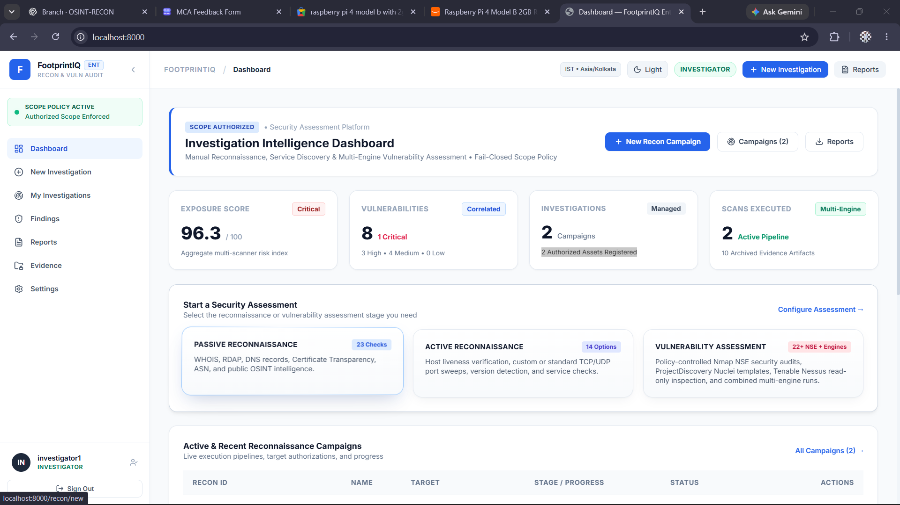
</p>

The **Administrator Oversight Dashboard** provides platform-wide visibility across all investigator campaigns, multi-target risk scoring, aggregated vulnerability counts, and centralized shortcuts for user governance, scanner engine diagnostics, and security audit trails.

<p align="center">
  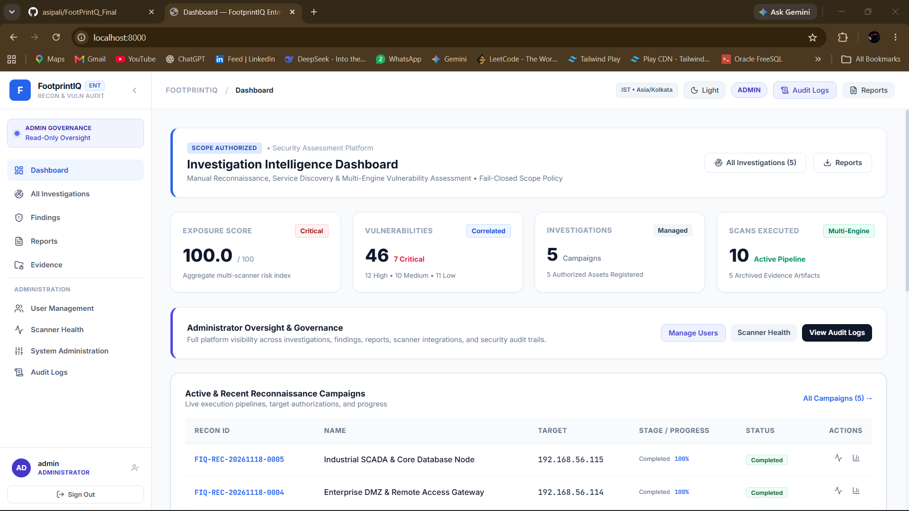
</p>

---

### B. Reconnaissance Campaign Management

The **Reconnaissance Campaign Directory** (`/recon`) serves as the central operational hub for managing multi-stage security engagements. Investigators track campaigns by unique collision-free Recon ID (`FIQ-REC-...`), campaign name and mission purpose (e.g., *Compliance Readiness Review*, *Passive OSINT Baseline*), designated target asset (`192.168.56.111`, `mozilla.org`), selected scan profiles (Passive Intelligence, Active Discovery, Nmap NSE, ProjectDiscovery Nuclei), pipeline progress percentage (0–100%), and lifecycle completion status (`Completed`, `Partially Completed`). The interface includes full-text search filtering and instant campaign initiation via the **Create New Recon** action.

<p align="center">
  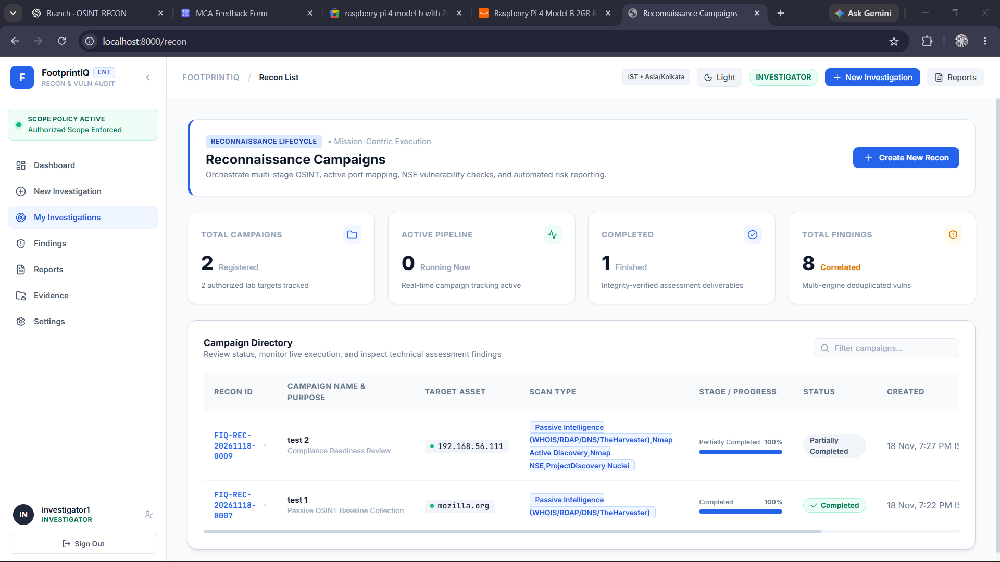
</p>

---

### C. Create New Investigation

The **Create New Recon** wizard (`/recon/new`) guides investigators through structured campaign onboarding with strict scope enforcement. Key inputs include **Recon Name**, **Target** (single IPv4/IPv6 address, CIDR subnet, or fully qualified domain name), and **Assessment Purpose**. Crucially, the wizard enforces a server-side **Target Authorization Confirmation** gate, requiring investigators to certify that the specified target falls within approved rules of engagement. Targets outside authorized CIDR ranges or unlisted domains are blocked by fail-closed authorization checks before any network traffic is transmitted.

<p align="center">
  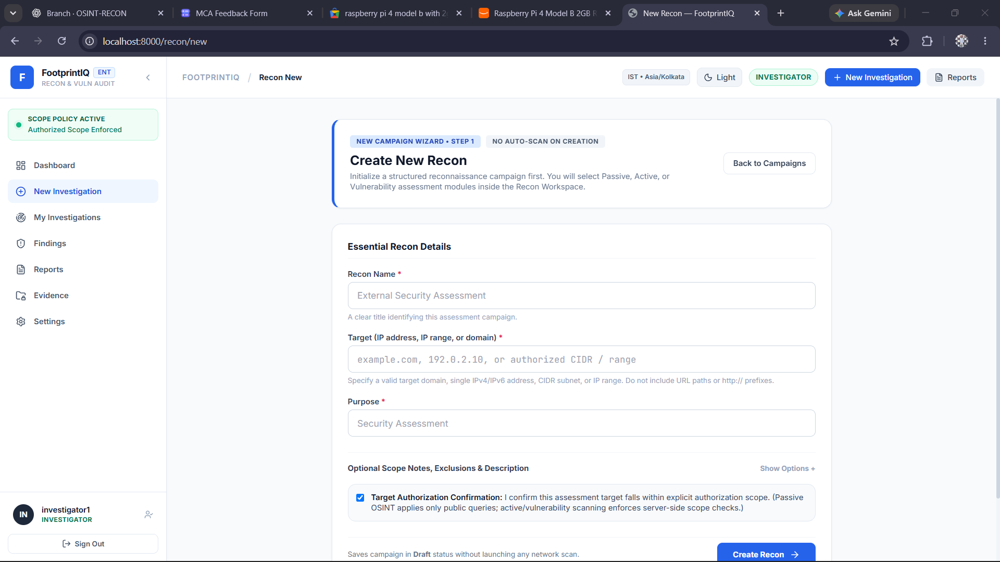
</p>

---

### D. Reconnaissance Workspace

The **Reconnaissance Workspace** (`/recon/{id}/workspace`) provides fine-grained, policy-governed control over all three assessment phases prior to scan dispatch:

- **Passive Reconnaissance Modules:** Granular configuration of **Domain Intelligence** (authoritative WHOIS, RDAP, standard and extended DNS records [A, AAAA, MX, NS, TXT, CNAME, SOA], nameserver diversity, Certificate Transparency subdomains, and SPF/DMARC/DNSSEC posture), **OSINT Intelligence** (public email harvesting via theHarvester, search engine indexing, registrant records, and passive technology stack inference), and **Infrastructure Intelligence** (IP/netblock resolution, reverse DNS PTR lookups, autonomous system number [ASN] mapping, and geolocation).
- **Active Reconnaissance Configuration:** Execution parameters for network discovery, including host liveness checks (`-Pn`), TCP connect scanning (`-sT`), custom port ranges (Top 1000 standard ports or 1–65535 full sweep), Nmap service and version detection (`-sV`), safe default discovery scripts (`-sC`), service banner extraction, OS fingerprinting (`-O`), timing templates (`-T3` Balanced), and targeted protocol analyzers (SSH algorithms, HTTP headers, SMB signing, MySQL, FTP anonymous login, and SSL/TLS cipher suites). Also includes the **Privilege Consent & Elevation (PSA)** checkbox for authorized raw-socket operations.
- **Vulnerability Assessment Engines & Policies:** Multi-scanner selection enabling allowlisted Nmap NSE scripts, ProjectDiscovery Nuclei template profiles (CVEs, misconfigurations, exposed panels, HTTP security), rate-limiting (requests/second), and Tenable Nessus integration settings with real-time license validation.

<p align="center">
  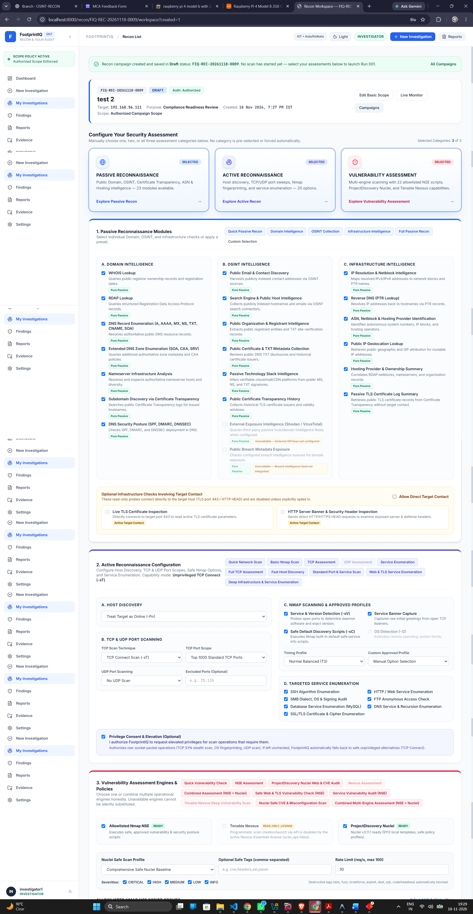
</p>

---

### E. Vulnerability Findings & Correlation

The **Vulnerability Findings & Correlation** table (`/findings`) aggregates and normalizes security discoveries across all assessment engines into a unified evidentiary ledger. Each finding details the **Target IP and Port** (e.g., `192.168.56.111:21`, `:25`, `:5432`), exposed **Service Protocol** (`tcp/ftp`, `tcp/smtp`, `tcp/postgresql`), standardized **Severity and CVSS Score** (Critical 9.8, High 7.5, Medium 4.3), standardized **CVE References** (e.g., `CVE-2011-2523` vsftpd backdoor, `CVE-2014-3566` POODLE), descriptive **Vulnerability Title & Actionable Remediation Guidance**, originating **Detection Engine** (`NSE`, `Nuclei`), and cryptographic **Verification Status** (`verified`).

<p align="center">
  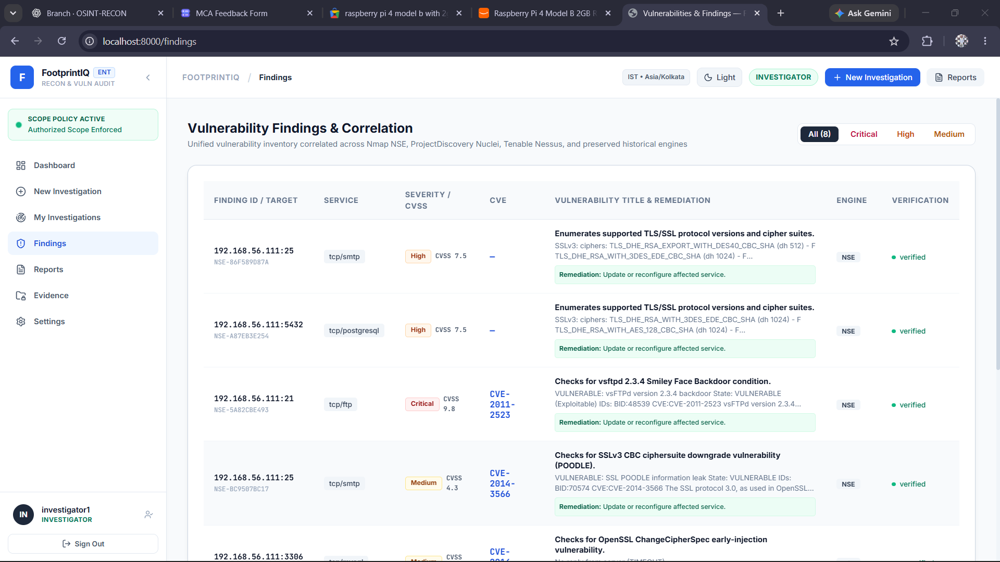
</p>

The **Investigation Entity & Relationship Graph** (`/recon/{id}/results`) correlates collected reconnaissance artifacts and vulnerability findings into an interactive topology. Target IP nodes (green) connect to discovered open ports and services (yellow), which link directly to corroborated vulnerability entities (red/orange). The right panel provides deep attribution metadata, entity taxonomy (`maltego.Vulnerability`), confidence ratings (95%), evidence references (`nse_script:ssl-poodle`), multi-scanner provenance breakdowns (e.g., 24 Nmap observations, 1 Nuclei match, 7 NSE scripts), and one-click export to **Maltego GraphML**, CSV, and JSON.

<p align="center">
  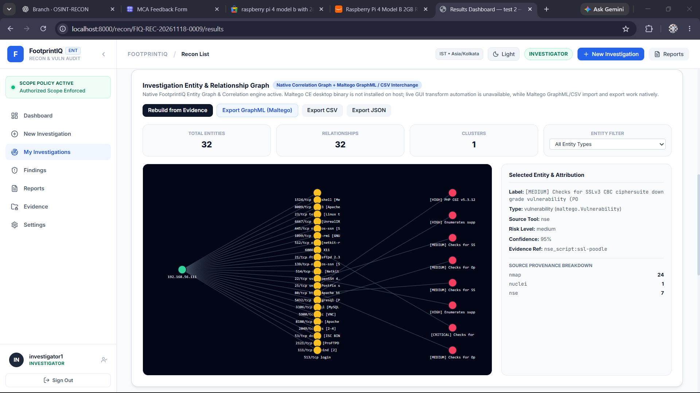
</p>

---

### F. Integrated Security Assessment Report

The **Integrated Security Assessment Report** (`/reports/{id}`) delivers executive-ready reporting and deep technical risk analysis for every completed investigation run. Core components include:

- **Executive Risk Index:** Asymptotic target risk calculation (e.g., `96.3 / 100 Critical`) based on finding severity, CVSS scores, asset context (23 open ports), and multi-engine corroboration.
- **Visual Risk Analytics:** Interactive Chart.js visualizations including **Severity Distribution** (donut chart), **Severity Counts Breakdown** (bar chart), **Finding Classification** (Confirmed vs. Potential vs. Informational), **Scanner Coverage & Tool Contribution** (horizontal bars across Nmap, NSE, Nuclei, and theHarvester), and **Affected Hosts & Vulnerability Categories** (Known CVEs, Misconfigurations, TLS/SSL Weaknesses).
- **Assessment Coverage & Limitations:** Transparent accounting of executed engines, partial stages, timeouts, and skipped checks.
- **Scan-to-Scan Baseline Comparison:** Remediation verification tracking changes between sequential scan runs (Run 001 baseline vs. Run 002 verification).
- **Executive Posture & Remediation Roadmap:** Plain-language executive risk drivers and prioritized, actionable remediation steps for engineering teams.

<p align="center">
  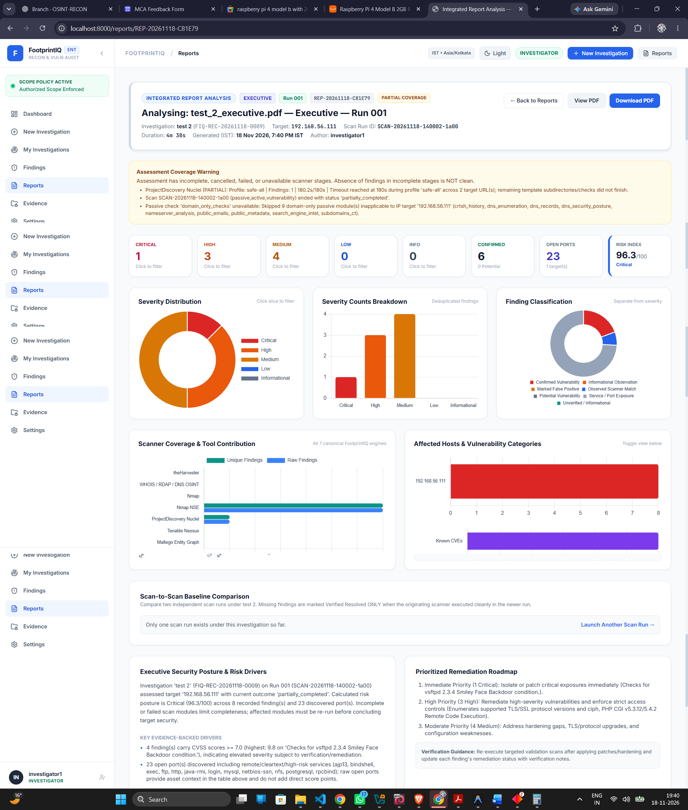
</p>

---

### G. Administrator & Governance

The **User Management & Investigation Sharing** portal (`/admin/users`) gives administrators strict control over platform access and investigator collaboration. Administrators review registered user accounts (`admin`, `investigator1`, `investigator2`), manage account active status, assign RBAC roles (Administrator vs. Investigator), and approve or suspend credentials. The **Investigation Sharing** panel enables granular delegation, allowing administrators to grant collaborating investigators read or write access to specific reconnaissance campaigns without exposing other investigations.

<p align="center">
  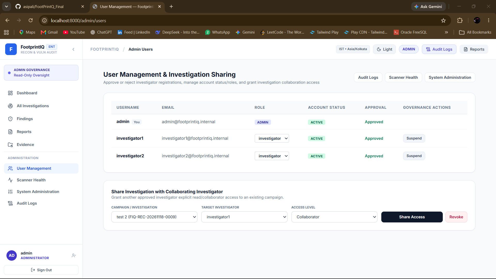
</p>

The **Security Audit Trail** (`/admin/audit-logs`) maintains an immutable, tamper-evident log of all security-critical operations across the platform. Every entry captures an exact timestamp (IST / UTC), acting **Actor** username, **Role**, standardized **Action** identifier (such as `ADMIN_ADD_LAB_RANGE`, `ADMIN_REMOVE_LAB_RANGE`, `LOGIN_SUCCESS`, `REPORT_ANALYZED`, `REPORT_GENERATED`, `RECON_SCAN_STARTED`), **Target Resource**, execution **Outcome** (`SUCCESS` / `DENIED`), client **Source IP**, and structured JSON **Event Details**.

<p align="center">
  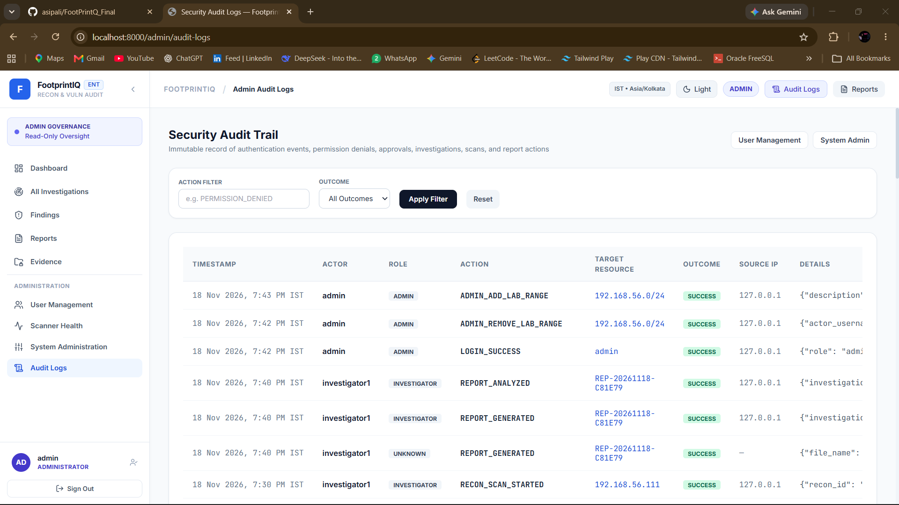
</p>

---

## 14. Roadmap

### Completed Capabilities
- [x] Multi-source passive OSINT collection (WHOIS, RDAP, DNS, theHarvester).
- [x] Controlled active network reconnaissance with Nmap (TCP SYN/Connect, UDP, service versioning, OS detection).
- [x] Template-based vulnerability assessment with ProjectDiscovery Nuclei (9,000+ YAML templates).
- [x] Policy-controlled Nmap Scripting Engine (NSE) vulnerability checks with category allowlisting.
- [x] Tenable Nessus REST API adapter with dynamic template discovery, scan lifecycle, and report export.
- [x] Asymptotic exposure risk scoring (0 - 100) and cross-scanner corroboration boost.
- [x] Distributed evidence preservation via SeaweedFS with SHA-256 cryptographic integrity verification.
- [x] Centralized Role-Based Access Control (RBAC) with `admin` and `investigator` role separation.
- [x] Privileged Scan Authorization (PSA) with ephemeral single-use 300s tickets and safe unprivileged fallback (Scenarios A–E).
- [x] Entity & Relationship Graph correlation with Maltego GraphML and CSV export.
- [x] Executive, Technical, and Combined Multi-Scanner PDF report generation via ReportLab.
- [x] Differential report analysis comparing scan runs over time with remediation velocity metrics.
- [x] Microsoft SQL Server 2022 Express support with 6 reversible Alembic T-SQL migrations and resilient in-memory fallback.
- [x] 239 passing automated unit, integration, and security tests.

### In-Progress Capabilities
- [ ] Integration of live Maltego Desktop local transformation server.
- [ ] Expanded certificate transparency log mining for passive subdomain enumeration.
- [ ] Scheduled recurring recon campaigns with automated webhook alerts.

### Planned Capabilities
- [ ] Multi-node distributed scanner agent worker pools across remote networks.
- [ ] STIX 2.1 / TAXII threat intelligence export interchange.
- [ ] Enterprise Single Sign-On (SSO) via SAML 2.0 / OpenID Connect (OIDC).

---

## 15. Responsible Use

> **FootprintIQ is intended for authorized security assessments, research and educational use. Users must obtain appropriate authorization before scanning systems or networks. The platform must not be used for unauthorized access, exploitation or disruption.**

The developers assume no liability and are not responsible for any misuse or damage caused by this software. Ensure all testing complies with local, state, and international cyber laws.

---

## 16. License and Contribution

### License
No license has been specified for this repository. All rights are reserved by the original authors and engineering team. Unauthorized copying, distribution, or commercial modification is strictly prohibited.

### Contribution Guidelines
Contributions, bug reports, and pull requests from authorized project collaborators are welcome:
1. Ensure all new code adheres to PEP 8 standards and includes strict type annotations.
2. Maintain fail-closed security: never bypass RBAC, target authorization, or scanner allowlists.
3. Every new feature must include automated unit/integration tests in `tests/`.
4. Ensure all 239 existing tests continue to pass before submitting pull requests:
   ```bash
   python -m unittest discover -s tests -p "test_*.py"
   ```
